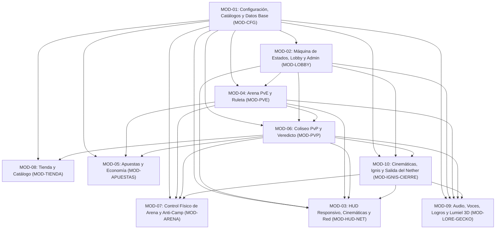

# Especificación de Requisitos por Módulos (SRS) — La Forja del Tártaro

# Cuadro de Versiones

| **Versión** | **Fecha** | **Autor (es)** | **Descripción** |
|---|---|---|---|
| 1.0 | 3-11-2026 | Juan | Versión inicial del documento de alcance |

**Fuentes integradas en este documento:**

1. **Base SRS (`[PDF]`):** `Requisitos-Modulo.pdf` (páginas 1–11; corregidos los errores de reconocimiento óptico de caracteres de la versión anterior contra el documento original). Plataforma indicada originalmente en el PDF: Minecraft 1.20.1 (Forge 47.4.10).
2. **Lore y Producción Audiovisual (`[Lore v6.0 - Propuesta]`):** *Guion integral de historia, diálogos, música, efectos, animaciones y transiciones — Versión 6.0* (presentación tipo *reencarnación isekai → infierno → fases*). Estado declarado en el guion: **propuesta integrada para validación y producción; no implica que cada escena técnica ya esté programada**.
3. **Estado de Implementación (`[Estado NeoForge]`):** Verificado contra el código actual en `mod/src/` (Minecraft 1.21.1 · NeoForge 21.1.265 · Java 21), [ESTADO.md](ESTADO.md) y [DECISIONES.md](DECISIONES.md).

> **Regla editorial:** este documento distingue explícitamente los requisitos base del PDF (`[PDF]`), las adiciones propuestas por el guion de lore (`[Lore v6.0]`) y lo implementado actualmente en NeoForge (`[Implementado]`, `[Parcial]`, `[Faltante]`, `[Conflicto / Por conciliar]`). No se resuelven contradicciones entre documentos por inferencia: cada discrepancia queda marcada como **decisión abierta** para aprobación del equipo.

---

## Convención de Identificadores y Estados

Cada requisito utiliza el formato `[CÓDIGO-MÓDULO]-[TIPO]-[NÚMERO]`:

- **`RF` (Requisito Funcional):** comportamiento funcional del sistema definido en el SRS base (`[PDF]`).
- **`RM` (Requisito de Migración):** cambio técnico de arquitectura al pasar al mod nativo (`[PDF]`).
- **`EXT` (Punto de Extensión):** interfaz o capacidad prevista para ampliar el módulo en el futuro (`[PDF]`).
- **`LORE` (Requisito Narrativo / Audiovisual):** requisito funcional, técnico o de recursos derivado del Guion v6.0 (`[Lore v6.0 - Propuesta]`).

**Etiquetas de revisión modular:**
- `Implementado`: escrito y compilado en `mod/src/` (la validación en partida puede seguir pendiente según [ESTADO.md](ESTADO.md)).
- `Parcial`: existe base parcial o variante simplificada en código; faltan partes del requisito.
- `Faltante`: no existe en el código ni en los recursos del mod.
- `Conflicto / Por conciliar`: existe divergencia entre el PDF, las reglas vigentes en [DECISIONES.md](DECISIONES.md) / NeoForge y el Guion v6.0.
- `Fuera de alcance (Jornada 1)`: reservado expresamente para entregas futuras (Módulos 08–09 del Guion v6.0).

---

## Mapa General de Módulos y Dependencias

---

## Correspondencia entre Fases Narrativas (Guion v6.0) y Módulos Técnicos (SRS)

| Fase del Guion v6.0 | Escenas clave | Módulos SRS implicados |
|---|---|---|
| **1. Reencarnación (isekai)** — Mod 00 | `00.1` Fin del ciclo, `00.2` Luz y promesa, `00.3` Registro (`░░░░░░░░`), `00.4` Corte seco/error, `00.5` Caída al Nether | `MOD-01`, `MOD-02`, `MOD-03`, `MOD-09`, `MOD-10` |
| **2. Infierno** — Mod 01 | `01.0` Crónica del Tártaro, `01.1` Voz entre rocas, `01.2` Ruta de la fundición, `01.3` Coliseo/argollas/muro, `01.4` Promesa y transición `01→02` | `MOD-01`, `MOD-02`, `MOD-03`, `MOD-07`, `MOD-09`, `MOD-10` |
| **3. La Forja (PvE)** — Mod 02 | Ruleta, combates PvE, Medidor de Integridad, umbrales `20/40/60/80 %` (4 Juramentos + «grietas») | `MOD-01`, `MOD-03`, `MOD-04`, `MOD-05`, `MOD-07`, `MOD-09` |
| **4. Liberación** — Mod 03 | `03.1` Última cadena (`100 %` Memoria raspada con marca de ala, `lumiel_liberacion`), `03.2` Sello de Ignis | `MOD-02`, `MOD-03`, `MOD-04`, `MOD-09`, `MOD-10` |
| **5. Veredicto (PvP)** — Mod 04 | `04.1` Propuesta, `04.2` Duelos y apuestas sin control mental, `04.3` Portador del Veredicto (`lumiel_veredicto`) | `MOD-05`, `MOD-06`, `MOD-07`, `MOD-09` |
| **6. Ignis** — Mod 05–06 | `05.1` Rayo al muro (`lumiel_rayo_muro`), `05.2` Fundición interior + *Dark Intro*, `06.1` Diálogo, `06.2` Combate cooperativo, `06.3` Caída y único Corazón de Custodia | `MOD-01`, `MOD-03`, `MOD-07`, `MOD-09`, `MOD-10` |
| **7. Salida del Nether (FIN)** — Mod 07 | `07.1` Duelo por Ignis, `07.2` Entrega del núcleo y portal, `07.3` Cruce del portal, cierre del registro (`░░░░░░░░`), sombra/motivo incierto, fin | `MOD-02`, `MOD-03`, `MOD-07`, `MOD-08` *(por conciliar)*, `MOD-09`, `MOD-10` |
| **Continuidad futura (fuera de entrega)** — Mod 08–09 | Survival en Overworld y futuro evento *El Último Corazón* (Lumiel oscuro) | **Fuera de alcance de la Jornada 1** |

---

## MÓDULO 01: Configuración, Catálogos y Datos Base (`MOD-CFG`)

*Origen base: configuración KubeJS (`00_forja_config.js`, `01_forja_catalogo.js`) y `ConfiguracionTorneo.java`.*

### Requisitos del SRS Base (`[PDF]`)

- **`CFG-RF-01` (Dimensión y Coordenadas):** Todas las coordenadas operativas del evento deben resolverse en la dimensión `minecraft:the_nether`, manteniendo el registro nominal de posiciones (`ESTADIO_INICIAL`, `LOBBY_ARENA`, `ESCENARIO_CENTRO`, `VESTIDOR_OESTE`, `VESTIDOR_ESTE`, `TIENDA`, `JEFE_CENTRO`, `WATCHER_ESTE`, `WATCHER_OESTE`, puertas, telarañas, maniquíes y carteles).
  - *Estado:* `Implementado` en [ConfiguracionTorneo.java](../mod/src/main/java/com/forja/evento/ConfiguracionTorneo.java).
- **`CFG-RF-02` (Perfiles de Tiempo Duales):** El sistema debe soportar dos tablas de tiempos conmutables mediante la bandera `MODO_PRUEBA`:
  - Tiempos Reales (`[PDF]`): `lobby: 180s`, `vestidor: 30s`, `apuestas: 30s`, `combatePve: 180s`, `combatePvp: 300s`, `intermision: 180s`, `entreDuelos: 10s`, `coronacion: 30s`.
  - Tiempos de Prueba (`[PDF]`): `lobby: 5s`, `vestidor: 5s`, `apuestas: 5s`, `combatePve: 180s`, `combatePvp: 180s`, `intermision: 5s`, `entreDuelos: 5s`, `coronacion: 5s`.
  - *Estado:* `Implementado` con valores vigentes en `ConfiguracionTorneo.java` (`tiempos.intermision = 120s`, `tiempos_prueba.combate_pvp = 60s`, `tiempos_prueba.preparacion_pvp = 30s`, `tiempos_prueba.apuestas_pve = 30s`, `tiempos_prueba.combate_pve = 180s`).
- **`CFG-RF-03` (Kit de Combate Provisional):** Todo combatiente debe recibir al entrar al vestidor: armadura completa de diamante, espada de diamante, 7 manzanas doradas (`minecraft:golden_apple`) y 4 perlas de Ender (`minecraft:ender_pearl`), limpiando previamente cualquier ítem anterior de su inventario.
  - *Estado:* `Implementado` en [ClasesTorneo.java](../mod/src/main/java/com/forja/evento/ClasesTorneo.java) (8 kits editables con valores iniciales de diamante + consumibles 7/4).
- **`CFG-RF-04` (Definición de Encuentros PvE):** La lista de encuentros debe definir nombre visible y arreglo de entidades con su `id`, lugar de aparición y vida máxima personalizada:
  1. Kobolediator: `cataclysm:kobolediator` (`300 HP` en `JEFE_CENTRO`).
  2. Ender Golem: `cataclysm:ender_golem` (`300 HP` en `JEFE_CENTRO`).
  3. Wadjet: `cataclysm:wadjet` (`300 HP` en `JEFE_CENTRO`).
  4. Aptrgangr: `cataclysm:aptrgangr` (`300 HP` en `JEFE_CENTRO`).
  5. Prowler y Watchers: `cataclysm:the_prowler` (`200 HP` en `JEFE_CENTRO`) + 2 `cataclysm:the_watcher` (`50 HP` cada uno en `WATCHER_ESTE` y `WATCHER_OESTE`).
  - *Estado:* `Implementado` mediante `ConfiguracionTorneo.java` + [PveTorneo.java](../mod/src/main/java/com/forja/evento/PveTorneo.java).
- **`CFG-RM-01` (Externalización en Config y JSON recargables):** Externalizar tiempos, coordenadas y banderas de módulos (`modulos.<nombre>.nativo`) en `config/forja-server.toml` (`ForgeConfigSpec` / `ModConfigSpec`), y los encuentros PvE y catálogo de tienda en archivos JSON dentro de `data/forja/` recargables con `/reload`.
  - *Estado:* `Parcial`. Tiempos/coordenadas/jefes/audio/IA están en `forja_evento-server.toml` (`ModConfigSpec`), pero no existen interruptores `modulos.<nombre>.nativo`, los encuentros PvE siguen en TOML (no JSON con `/reload`), y la tienda usa recurso interno `/forja/tienda.json` sin recarga con `/reload`.
- **`CFG-EXT-01` (Extensión de Encuentros y Kits):** Permitir añadir en el JSON de encuentros atributos opcionales por entidad (`armadura`, `efectosPocion`, `escala`, `iconoRuleta`) y definir kits distintos por fase (ej. kit PvE vs. kit PvP) sin modificar código Java.
  - *Estado:* `Faltante` (los 8 kits diferencian `sala2` pero no existen aún kits distintos por fase ni JSON de encuentros con atributos opcionales).

### Nuevos Requisitos de Lore (`[Lore v6.0 - Propuesta]`)

- **`CFG-LORE-01` (Posiciones Escénicas del Lore en el Nether):** Ampliar el registro nominal de posiciones en `minecraft:the_nether` para incluir: plataforma/zona segura de caída y reencarnación (`00.5`), trazado de la ruta luminosa de la fundición (`01.2`), ubicación de las 5 argollas y del muro reforzado (`01.3` / `05.1`), corredor interior de la fundición (`05.2`), cámara de custodia y aparición de Ignis (`06.1`), punto del núcleo de custodia (`06.3` / `07.2`) y portal de salida del Nether (`07.2`–`07.3`).
  - *Estado:* `Faltante`.
- **`CFG-LORE-02` (Catálogo Único de Música Gratuita, SFX, Licencias y Exclusiones):** Configurar el banco único de pistas por escena (`M00_LIMBO`, `M00_LUZ`, `M00_CAIDA`, `M01_CRONICA`, `M01_DESPERTAR`, `M02_TENSION`, `M02_PVE_A..D`, `M03_LIB`, `M04_PREP`, `M05_RUTA`, `M05_IGNIS`, `M06_DIALOGO`, `M06_COMBATE`, `M07_DUELO`, `M07_ENTREGA`, `M07_SALIDA`), sus alternativas para pruebas A/B, los 3 estados del Motivo de Lumiel (`Clara`, `Incierta`; `Oscura` reservada) y los SFX narrativos (`S_LATIDO` a `S_SOMBRA`). Mantener validación/documentación de licencias (solo `CC0` y `CC BY 4.0/3.0` con registro en `CREDITOS.md`; prohibidas `CC BY-SA`, `GPL`, `NC`, pistas con voces/coros y *Heaven Theme Loop*).
  - *Estado:* `Faltante` (el mod actual solo configura 6 pistas heredadas en `ConfiguracionTorneo` para MuSync).
- **`CFG-LORE-03` (Tablas de Diálogos, Inscripciones de Juramentos y Textos de Registro):** Externalizar en JSON/recursos los textos en **español neutro latinoamericano** (uso de «ustedes», sin regionalismos ni voseo) para: pantalla del Registro de Reencarnación (`00.3` y `07.3`), Crónica del Tártaro (`01.0`), las 5 inscripciones y reacciones («grietas») de los Cinco Juramentos (`20/40/60/80/100 %`), líneas rotativas de Lumiel, diálogos de Ignis, Narrador, Voz del Registro, variantes de seguridad y subtítulos obligatorios.
  - *Estado:* `Faltante`.
- **`CFG-LORE-04` (Configuración del Encuentro Cooperativo Final — Ignis):** Definir la configuración específica del custodio `cataclysm:ignis` (vida, atributos, textos, pista OST/respaldo y único `Corazón de Custodia`), separado del sorteo PvE de ruleta.
  - *Estado:* `Faltante`.

---

## MÓDULO 02: Máquina de Estados Global, Lobby y Administración (`MOD-LOBBY`)

*Origen base: `10_forja_lobby.js`, [ControladorTorneo.java](../mod/src/main/java/com/forja/evento/ControladorTorneo.java) y [DatosTorneo.java](../mod/src/main/java/com/forja/evento/DatosTorneo.java).*

### Requisitos del SRS Base (`[PDF]`)

- **`LOB-RF-01` (Secuencia de Estados del Torneo):** Mantener un único estado global persistente con secuencia: `DETENIDO -> LOBBY_CUENTA -> LLEGADA_ESTADIO -> INTERMISION_PVE -> LOBBY_ARENA -> (Ciclo PvE) -> INTERMISION_PVP -> PVE_TERMINADO -> (Ciclo PvP) -> CORONACION -> TIENDA`.
  - *Estado:* `Conflicto / Por conciliar`. En NeoForge actual ([DatosTorneo.java](../mod/src/main/java/com/forja/evento/DatosTorneo.java)) los estados llegan a `CORONACION -> ESPERANDO_SUPERVIVENCIA -> TIENDA` (y `ESPERANDO_SUPERVIVENCIA` está pendiente). El Guion v6.0 propone insertar fases de Reencarnación/Crónica al inicio y reemplazar el cierre por `Veredicto PvP -> Muro/Ruta -> Ignis -> Salida del Nether [FIN]`.
- **`LOB-RF-02` (Inicialización de Edición):** Al ejecutar iniciar desde `DETENIDO`:
  1. Limpiar etiquetas de torneo de los jugadores (`participante`, `jugador1`, `jugador2`, `lista0`, `lista1`, `lista2`, `fase2superada`, `esperando`, `campeon`, `descalificado`).
  2. Asignar etiqueta `participante` y unir al equipo `forja_lobby` (`friendlyFire = false`).
  3. Inicializar saldo en `puntosIniciales` (200) y reiniciar contadores de ronda/apuesta. *(Nota [DECISIONES.md](DECISIONES.md): en NeoForge vigente los saldos acumulados previos por UUID se conservan entre eventos; los nuevos jugadores reciben 200).*
  4. Mostrar temporizador `"La Forja se abre en..."` y anuncio inicial `"La Forja del Tártaro"`.
  - *Estado:* `Parcial`. `ControladorTorneo` inscribe participantes por UUID, limpia `campeon` y `lista*`, protege contra daño entre participantes (salvo duelistas activos) y conserva saldos por UUID en `DatosEconomia`; no crea equipo vanilla `forja_lobby` ni usa scoreboard `apuesta_j1`/`apuesta_j2` ni todas las tags legacy.
- **`LOB-RF-03` (Transición al Estadio):** Al concluir `LOBBY_CUENTA`, teletransportar participantes a `ESTADIO_INICIAL`, modo `adventure`, `/spawnpoint` en `LOBBY_ARENA`, vaciar inventario y aplicar `slow_falling` durante 15 segundos.
  - *Estado:* `Parcial`. `ControladorTorneo.preparar()` teletransporta a `ESTADIO_INICIAL`, fija `/spawnpoint` en `LOBBY_ARENA` y cambia a `adventure`, pero **falta vaciar el inventario y aplicar `slow_falling` 15 s**.
- **`LOB-RF-04` (Reconexión y Reaparición Segura):** Si un jugador se conecta o reaparece mientras el estado no es `DETENIDO`, reasignarle modo (`adventure`, `survival` o `spectator`) y teletransportarlo a la coordenada que corresponda a su rol en la ronda activa.
  - *Estado:* `Implementado` (con soporte adicional de visitantes tardíos en [VisitantesEvento.java](../mod/src/main/java/com/forja/evento/VisitantesEvento.java) y pausa de encuentro en [PausaEncuentro.java](../mod/src/main/java/com/forja/evento/PausaEncuentro.java), pendiente validar en partida).
- **`LOB-RF-05` (Comandos de Administración):** Registrar bajo nivel de permiso 2 los comandos de control y prueba (`/forja iniciar`, `/forja detener`, `/forja estado`, `/forja terminar_combate`, `/forja pve iniciar`, `/forja pve prueba`, `/forja prueba matar <jefe|jugador>`, `/forjapvp iniciar`, `/forjapvp prueba`, `/forjapvp matar <jugador1|jugador2>`).
  - *Estado:* `Parcial`. En NeoForge existen `/forja_nativo iniciar|detener|estado|hud|musica`, `/forja_pve prueba matar jefe`, `/forja_pvp prueba empate`, `/forja_tienda prueba|cerrar_prueba`. **Faltan:** `/forja terminar_combate`, `/forja pve iniciar`, `/forja pve prueba` (participantes NPC), `/forja prueba matar jugador`, `/forjapvp iniciar`, `/forjapvp prueba` y `/forjapvp matar <j1|j2>`.
- **`LOB-RM-01` (`SavedData` Tipado):** Reemplazar cadenas JSON en `server.persistentData` por `SavedData` tipado.
  - *Estado:* `Implementado` ([DatosTorneo.java](../mod/src/main/java/com/forja/evento/DatosTorneo.java) y [DatosEconomia.java](../mod/src/main/java/com/forja/evento/economia/DatosEconomia.java)).
- **`LOB-EXT-01` (Pausa Administrativa en Caliente):** Añadir `/forja pausar` y `/forja reanudar` para congelar el temporizador de cualquier estado e inmovilizar entidades en caso de caída de conexión.
  - *Estado:* `Parcial`. La congelación automática por desconexión de combatiente existe en [PausaEncuentro.java](../mod/src/main/java/com/forja/evento/PausaEncuentro.java), pero **faltan los comandos manuales `/forja pausar` y `/forja reanudar`**.

### Nuevos Requisitos de Lore (`[Lore v6.0 - Propuesta]`)

- **`LOB-LORE-01` (Flujo Extendido de 7 Fases del Primer Evento):** Ampliar la máquina de estados para contemplar:
  1. `REENCARNACION` (Módulo 00 del guion: escenas `00.1`–`00.5` en zona segura del Nether).
  2. `CRONICA_Y_RUTA` (Módulo 01 del guion: `01.0` Crónica, `01.1` Voz entre rocas, `01.2` Ruta de la fundición, `01.3`–`01.4` Llegada al coliseo y promesa).
  3. `LA_FORJA_PVE` (Módulo 02 del guion).
  4. `LIBERACION_CADENA` (Módulo 03 del guion: rotura de última cadena y 5.º Juramento).
  5. `VEREDICTO_PVP` (Módulo 04 del guion: duelos y Portador del Veredicto).
  6. `RUTA_E_IGNIS` (Módulos 05–06 del guion: rayo al muro, corredor interior, aparición, diálogo y combate con Ignis).
  7. `SALIDA_NETHER` (Módulo 07 del guion: duelo, entrega del Corazón de Custodia, cruce del portal y `DETENIDO` / fin del evento).
  - *Estado:* `Faltante` / `Conflicto / Por conciliar` con `ESPERANDO_SUPERVIVENCIA -> TIENDA`.
- **`LOB-LORE-02` (Reglas de Jornada Única, Sin Dimensión Nueva e Inventario Intacto):** Todos los participantes entran juntos; los ingresos tardíos no participan ni alteran el curso narrativo (`VisitantesEvento` ya los restringe a espectador). La cinemática de reencarnación se reproduce en el Nether sin crear dimensión nueva, sin otorgar poderes/objetos ni alterar el inventario. El evento concluye al cruzar el último participante el portal de salida del Nether (sin límite horario fijo para la última salida ni escenas en el Overworld).
  - *Estado:* `Parcial` (`VisitantesEvento` ya aísla ingresos tardíos; falta el flujo de reencarnación y cierre en portal del Nether).
- **`LOB-LORE-03` (Orquestación de Cues y Disparadores de Operador — `C-0` a `C-19`):** Los cambios musicales y narrativos se disparan exclusivamente por confirmación de estado del servidor o por acción explícita del operador, **nunca por reloj ciego durante combates de duración imprevisible**. El operador debe poder disparar manualmente las variantes de seguridad (empate/repetición/pausa en PvP; desconexión/abandono; variante de duda al entregar el núcleo) y contar con plan de cancelación/reinicio por cue.
  - *Estado:* `Faltante`.
- **`LOB-LORE-04` (Separación Estricta Resultado → Señal Audiovisual):** Garantizar que todo efecto narrativo (inscripciones, reacciones de Lumiel, caída de Ignis, apertura de salida) se active **después** de que el servidor confirme el resultado oficial.
  - *Estado:* `Parcial` (se cumple en PvE/PvP actuales; falta implementarlo para los nuevos hitos de lore).

---

## MÓDULO 03: Interfaz Gráfica (HUD Responsivo), Cinemáticas y Red (`MOD-HUD-NET`)

*Origen base: `05_forja_painter.js`, [HudForja.java](../mod/src/main/java/com/forja/evento/cliente/HudForja.java) y mensajes de red en `mod/src/main/java/com/forja/evento/`.*

### Requisitos del SRS Base (`[PDF]`)

- **`HUD-RF-01` (Escalado Responsivo Universal):** Todos los elementos visuales se posicionan y escalan en proporción a `$screenW` y `$screenH` sin desbordarse en ninguna resolución o escala de GUI.
  - *Estado:* `Implementado` en `HudForja.java` + `hud.json` (pendiente validar múltiples resoluciones en partida).
- **`HUD-RF-02` (Temporizador del Tártaro):** Barra superior centrada (`w = 48% screenW`), 3 capas (`timer_empty`, `timer_fill`, `timer_frame`), reloj `MM:SS` con cambio de color urgente (`<= 10 s`, `#FFAA00` a `#FF3333` en PDF; configurable en `hud.json` como `#FFD700` / `#FF2A2A`) y subtítulo de fase.
  - *Estado:* `Implementado` en `HudForja.java`.
- **`HUD-RF-03` (Ruleta Horizontal de 5 Casillas):** Carrusel centrado (`w = 56% screenW`), 5 iconos en orden fijo (`kobolediator`, `ender_golem`, `wadjet`, `aptrgangr`, `prowler_and_watcher`), resplandor, flecha superior y subtítulo con autoescala.
  - *Estado:* `Implementado` en `HudForja.java` + [HudRuletaTorneo.java](../mod/src/main/java/com/forja/evento/HudRuletaTorneo.java).
- **`HUD-RF-04` (Barras de Combate Verticales Duales):** Dos barras verticales (`h = 52% screenH`) al `8 %` y `92 %`, recorte vertical de abajo hacia arriba sin deformar, mostrando vida combinada de entidades del encuentro en PvE o de ambos jugadores en PvP.
  - *Estado:* `Implementado` en `HudForja.java` + [HudBarrasTorneo.java](../mod/src/main/java/com/forja/evento/HudBarrasTorneo.java).
- **`HUD-RF-05` (Anuncios Centrados en Pantalla):** Reemplazo de títulos vanilla por texto centrado con escala dinámica (`72 %` título, `78 %` subtítulo) y apagado automático tras `NN` ticks / duración configurada.
  - *Estado:* `Implementado` en `HudForja.java` (`duracion_segundos: 4`).
- **`HUD-RM-01` (Overlays, Red e Interpolación):** Implementar overlays en cliente, sincronizar por red y **interpolar en cliente a los FPS nativos del jugador**.
  - *Estado:* `Parcial`. Usa `RegisterGuiLayersEvent` y `CustomPacketPayload` de NeoForge 1.21.1 (`HudMensaje`, `HudRuletaMensaje`, `HudBarrasMensaje`, `AudioVolumenMensaje`), pero **no interpola suavemente las barras ni el temporizador entre ticks a FPS nativos**.
- **`HUD-EXT-01` (Efectos Visuales de Daño):** Permitir parpadeo en blanco o agitación de la barra vertical durante 4 fotogramas cuando se pierda más del `10 %` de la vida en un golpe.
  - *Estado:* `Faltante`.

### Nuevos Requisitos de Lore (`[Lore v6.0 - Propuesta]`)

- **`HUD-LORE-01` (Reproductor de Cinemáticas de Cliente — `CinematicPlayer` / `cinematica_reencarnacion`):** Implementar controlador de pantalla completa en cliente para el Módulo 00: pantalla negra (`00.1`), fundido a blanco cálido (`00.2`), grieta de luz (`00.4`), fundido de blanco a rojo (`00.5`) y retorno limpio a cámara normal. Debe incluir **tecla de omisión accesible** (`Plan B`).
  - *Estado:* `Faltante`.
- **`HUD-LORE-02` (Ventana de Registro de Reencarnación — `registro_ventana`):** Dibujar la ficha UI de registro sobre pantalla en `00.3` (inicio) y `07.3` (cierre al cruzar el portal) mostrando `[jugador]`, estado, destino `Overworld`, bendición/autorización y la última línea ilegible (`Destino alterado por: ░░░░░░░░` / `Observación: ░░░░░░░░`), sincronizada línea a línea con `S_VENTANA` y dejando la última línea en silencio.
  - *Estado:* `Faltante`.
- **`HUD-LORE-03` (Medidor de Integridad de Ataduras y `InscriptionDisplay`):** Mostrar en HUD/pantalla el medidor de Integridad de las Ataduras (`100 % → 0 %`) y desplegar visualmente las inscripciones de los Cinco Juramentos (`20/40/60/80 %`, y `100 %` raspada con marca de ala) como subtítulo destacado, letrero o libro/panel en cliente (`InscriptionDisplay`), evitando activarlos antes de la confirmación oficial.
  - *Estado:* `Faltante`.
- **`HUD-LORE-04` (Subtítulos Universales y Plan B Audiovisual):** Mostrar subtítulos sincronizados para **todas** las líneas de voz (Lumiel, Ignis, Narrador, Voz del Registro) como requisito obligatorio de accesibilidad y Plan B si falla la reproducción de audio.
  - *Estado:* `Faltante`.
- **`HUD-LORE-05` (Gestor Cliente de Audio, Cues y Configuración — `AudioManager`, `SceneCuePlayer`, `ClientConfig`):** Incorporar paquetes servidor→cliente para cues narrativos (`C-0`..`C-19`), reproducción de voces/SFX/música en cliente con: fundidos (`fade-in`/`fade-out`), **corte seco instantáneo** (`C-2` en `00.4`), atenuación automática de música (`ducking` de `-8 a -12 dB` con restauración en `1–3 s` al entrar voz principal), jerarquía de prioridad (`advertencias de ataques > diálogos críticos > SFX narrativos > música`) y `ClientConfig` para volúmenes locales.
  - *Estado:* `Faltante` (actualmente solo existe `VolumenMusicaCliente` + mixins de volumen para MuSync, sin ducking, fades, voces ni reproductor de cues).

---

## MÓDULO 04: Arena PvE, Ruleta del Destino y Juicio de las Ataduras (`MOD-PVE`)

*Origen base: `20_forja_pve_apuestas.js` y [PveTorneo.java](../mod/src/main/java/com/forja/evento/PveTorneo.java).*

### Requisitos del SRS Base (`[PDF]`)

- **`PVE-RF-01` (Cola de Turnos sin Repetición):** Reunir inscritos conectados y barajarlos (Fisher-Yates) para dar exactamente 1 turno de hasta `jefesPorJugador` (2) combates.
  - *Estado:* `Implementado` en `PveTorneo.java`.
- **`PVE-RF-02` (Preparación en Vestidor):** Enviar espectadores a `LOBBY_ARENA` (`adventure`), cerrar puertas, mover al combatiente a `VESTIDOR_ESTE` (`survival`) con kit y abrir apuestas durante `vestidor` (30 s).
  - *Estado:* `Implementado` en `PveTorneo.java`.
- **`PVE-RF-03` (Sorteo de la Ruleta):** Elegir encuentro evitando repetir el último jefe sorteado para ese mismo jugador (`encounter !== lastBoss`), ejecutando giro con desaceleración y celebración parpadeante (`40` ticks / configurable).
  - *Estado:* `Implementado` en `PveTorneo.java` + [SecuenciaRuleta.java](../mod/src/main/java/com/forja/evento/SecuenciaRuleta.java) + `HudRuletaTorneo`.
- **`PVE-RF-04` (Invocación y Combate):** Invocar entidades con `MAX_HEALTH` y salud inicial configuradas, abrir puertas, pasar espectadores a `spectator` en `ESCENARIO_CENTRO`, actualizar barras cada 4 ticks y mostrar cuenta regresiva en actionbar durante los últimos 10 s.
  - *Estado:* `Parcial`. Invocación, puertas, espectadores y barras cada 4 ticks implementados (más mejoras de IA en [IaCombate.java](../mod/src/main/java/com/forja/evento/IaCombate.java)); **falta mostrar cuenta regresiva en el actionbar durante los últimos 10 segundos** y la etiqueta de entidades usa `forja_pve_<uuid>` en vez de `forja_pve_jefe`.
- **`PVE-RF-05` (Resolución y Clasificación por Grupos):** Victoria (`remaining == 0`) premia al combatiente y si lleva `< 2` jefes vuelve a `VESTIDOR_ESTE`; derrota finaliza su turno y clasifica en `lista0`, `lista1` o `lista2`; pausa de 5 s (`PVE_PAUSA`) entre participantes y paso a `INTERMISION_PVP` al vaciar la cola.
  - *Estado:* `Implementado` (con premio corregido a 50 pts según [DECISIONES.md](DECISIONES.md) frente a 100 del PDF).
- **`PVE-RM-01` (Instanciación Nativa Java):** Sustituir `/summon` SNBT por `EntityType.create` y atributos nativos.
  - *Estado:* `Implementado` en `PveTorneo.invocar()`.
- **`PVE-EXT-01` (Modificadores de Ronda):** Asociar reglas opcionales por encuentro (lluvia de proyectiles, piso ardiente, límite de esbirros con `EntityJoinLevelEvent`).
  - *Estado:* `Faltante` (el `EntityJoinLevelEvent` en `PveTorneo` solo etiqueta proyectiles y limpia entidades huérfanas; no existen modificadores de ronda configurables).

### Nuevos Requisitos de Lore (`[Lore v6.0 - Propuesta]`)

- **`PVE-LORE-01` (Integridad de las Ataduras sin Caída de Núcleos en Minijefes):** Vincular las victorias PvE confirmadas al medidor de Integridad de las Ataduras (`100 % → 0 %`). Los jefes de la ruleta representan ecos convocados por el Tártaro (no los Cinco Protectores) y **ningún minijefe PvE debe otorgar un corazón o núcleo**.
  - *Estado:* `Faltante` (la regla de no soltar corazones se cumple por diseño actual, pero falta el medidor de Integridad y su progresión).
- **`PVE-LORE-02` (Umbrales de los Cuatro Primeros Juramentos — `C-7b`):** Solo tras confirmar la victoria PvE oficial, si la Integridad cruza `20 %` (**de la Piedra**), `40 %` (**de la Marea**), `60 %` (**de la Raíz**) u `80 %` (**de la Tormenta**), reproducir `S_INSCRIPCION` (1–2 s), mostrar la inscripción correspondiente y disparar la reacción («grieta») de Lumiel. El umbral `100 %` se reserva para el cierre de la fase PvE.
  - *Estado:* `Faltante`.
- **`PVE-LORE-03` (Audio, Diálogos y Reacciones de Lumiel en PvE):**
  - Ruleta/apuestas: clics de engranaje + cama de tensión opcional muy baja (`Insistent` / `Dark Place`), sin adelantar resultado.
  - Combate PvE: rotar pista musical distinta por jefe (`M02_PVE_A..D`, sin repetir ni usar *Heaven Theme Loop*); emitir líneas de Lumiel en 1.ª ronda, victorias (4 variantes A–D rotativas), derrotas (2 variantes A–B rotativas), caída opcional de jugador y advertencia próxima a la última cadena.
  - Victoria confirmada (`C-7`): bajar tema combate `-6 a -12 dB` con fundido, `S_CHAIN_BREAK`, **primera nota del Motivo de Lumiel** (sin fanfarria) y animación corta `lumiel_dolor_sello` volviendo a `lumiel_idle_encadenado` (evitar partículas por tick).
  - Derrota: apagar música dejando solo ambiente de arena; no celebrar ni reducir integridad.
  - *Estado:* `Faltante`.
- **`PVE-LORE-04` (Transición `02 → 03` — Liberación de la Última Cadena `C-8`):** Cuando la barra de Integridad alcance cero por victoria confirmada (nunca por derrota), detener música de combate, bajar sonido de fundición, mantener silencio `2–3 s` y disparar la escena `03.1` de Liberación (5.ª inscripción **de la Memoria** raspada con marca de ala, `S_CHAIN_WINCH` + `S_CHAIN_BREAK` sin batería, animación `lumiel_liberacion` con **iris azul**, *Incredulity* + Motivo completo de Lumiel) seguida de `03.2` (explicación del sello de Ignis).
  - *Estado:* `Faltante`.

---

## MÓDULO 05: Sistema de Apuestas y Economía (`MOD-APUESTAS`)

*Origen base: `20_forja_pve_apuestas.js`, `30_forja_pvp.js` y paquete [com.forja.evento.economia](../mod/src/main/java/com/forja/evento/economia/ServicioApuestas.java).*

### Requisitos del SRS Base (`[PDF]`)

- **`BET-RF-01` (Escaparate Físico de Apuestas):** Invocar 2 maniquíes (`MANIQUI_JUGADOR`, `MANIQUI_JEFE`) con nombres de contendientes y colocar 6 carteles interactivos (`50`, `100`, `allin` por bando) más **2 carteles de nombre**, limpiando al cerrar apuestas.
  - *Estado:* `Parcial`. Maniquíes y 6 (o 4 sin all-in) carteles interactivos implementados con limpieza y recuperación en [CartelesApuestas.java](../mod/src/main/java/com/forja/evento/economia/CartelesApuestas.java); **faltan los 2 carteles decorativos separados de nombre** ([PVP_NEOFORGE.md](PVP_NEOFORGE.md)).
- **`BET-RF-02` (Comandos de Apuesta para Jugadores):** Comandos `/apostar` y `/apostarpvp` accesibles sin OP.
  - *Estado:* `Parcial` / `Renombrado`. Implementado comando unificado `/forjapuntos apostar <1|2> <opcion1|opcion2|todo>` y `/forjapuntos saldo` en [ComandosApuestas.java](../mod/src/main/java/com/forja/evento/economia/ComandosApuestas.java) (no existen alias `/apostar` ni `/apostarpvp`).
- **`BET-RF-03` (Validaciones de Integridad):** Rechazar fuera de ventana, limitar a 1 apuesta por ronda, validar saldo `> 0` y suficiente, descontar inmediatamente. *(Incluye restricción de combatientes en `PermisosApuesta.java`).*
  - *Estado:* `Implementado` en [ServicioApuestas.java](../mod/src/main/java/com/forja/evento/economia/ServicioApuestas.java) y [LibroPuntos.java](../mod/src/main/java/com/forja/evento/economia/LibroPuntos.java).
- **`BET-RF-04` (Liquidación y Pagos):** Pago `2x` al acierto, devolución íntegra en empate/cancelación, sin devolución en derrota.
  - *Estado:* `Implementado` en `LibroPuntos.java` y [RecuperacionApuestas.java](../mod/src/main/java/com/forja/evento/economia/RecuperacionApuestas.java).
- **`BET-RM-01` (Clic en Carteles y Paquete `C2SBet`):** Soportar clic en carteles y paquete cliente→servidor `C2SBet` validado en servidor.
  - *Estado:* `Parcial` (clic en carteles implementado; no existe paquete `C2SBet` porque aún no hay GUI de apuestas en cliente).
- **`BET-EXT-01` (`PayoutStrategy` Configurable):** Desacoplar fórmula de pago para alternar Pago Fijo `2x` vs Pozo Proporcional (Pari-Mutuel).
  - *Estado:* `Faltante` (el multiplicador es configurable en `LibroPuntos`, pero solo aplica pago fijo multiplicado, no pozo Pari-Mutuel).
- **`BET-EXT-02` (Restricción de Autocompra):** Impedir que un combatiente apueste en contra de sí mismo (o en su propio duelo).
  - *Estado:* `Implementado` en [PermisosApuesta.java](../mod/src/main/java/com/forja/evento/economia/PermisosApuesta.java) (excluye a los combatientes de la ronda de toda apuesta en ese encuentro).

### Nuevos Requisitos de Lore (`[Lore v6.0 - Propuesta]`)

- **`BET-LORE-01` (Independencia Total frente al Guion):** Ningún evento narrativo (inscripciones de juramentos, dudas al entregar el núcleo de Ignis, diálogos de Lumiel, animaciones del Ojo o estatus de Portador del Veredicto) puede modificar elegibilidad, montos, tiempos ni resultados de apuestas.
  - *Estado:* `Implementado por diseño` (regla de cumplimiento continuo al incorporar `MOD-09` y `MOD-10`).
- **Conciliación Económica (`[PDF]` vs `[DECISIONES.md]`):**
  - El PDF indica `+100` PvE, `+100` PvP, `+2000` campeón.
  - [DECISIONES.md](DECISIONES.md) y `ConfiguracionTorneo.java` fijan `50` PvE, `50` PvP, `500` campeón y `300` supervivencia final (y el Guion v6.0 no introduce nuevos pagos ni altera las reglas de puntos).

---

## MÓDULO 06: Coliseo PvP, Emparejamiento y Veredicto (`MOD-PVP`)

*Origen base: `30_forja_pvp.js` y [PvpTorneo.java](../mod/src/main/java/com/forja/evento/PvpTorneo.java).*

### Requisitos del SRS Base (`[PDF]`)

- **`PVP-RF-01` (Emparejamiento Ordenado por Mérito PvE):** Construir cola de no descalificados, barajar aleatoriamente y ordenar por mérito PvE (`lista0 -> lista1 -> lista2`).
  - *Estado:* `Implementado` en `PvpTorneo.ordenar()`.
- **`PVP-RF-02` (Preparación de Duelo 1v1):** Extraer primeros 2 jugadores (`VESTIDOR_OESTE` y `VESTIDOR_ESTE`), equipar kit `survival` y abrir apuestas PvP (`vestidor` 30 s).
  - *Estado:* `Implementado` en `PvpTorneo.preparar()`.
- **`PVP-RF-03` (Desarrollo y Resolución del Duelo):** Cerrar apuestas, abrir puertas, espectadores a `ESCENARIO_CENTRO`, reloj `combatePvp` (300 s); victoria suma puntos y agrega a `winners`; empate descalifica a ambos y reembolsa apuestas.
  - *Estado:* `Implementado` en `PvpTorneo.java` (con pausa por desconexión mediante `PausaEncuentro`; `descalificado` se controla por expulsión de `ganadores` más que por etiqueta scoreboard).
- **`PVP-RF-04` (Avance de Rondas y Coronación):** Si queda `<= 1` en cola y hay `winners`, reordenar y seguir; si quedan `< 2` en total: 1 sobreviviente -> `CORONACION` (`ESCENARIO_CENTRO`, tag `campeon`, premio y `torneo:campeon`); 0 sobrevivientes -> `"NADIE ES DIGNO..."`; tras 30 s pasar a la fase siguiente (`TIENDA` en PDF / `ESPERANDO_SUPERVIVENCIA` en NeoForge).
  - *Estado:* `Parcial` / `Conflicto / Por conciliar`. Implementado hasta `ESPERANDO_SUPERVIVENCIA`; pendiente conciliar qué ocurre tras la coronación (Supervivencia/Tienda vs Ruta hacia Ignis).
- **`PVP-EXT-01` (Visualización de Llaves / Bracket):** Exponer `queue` y `winners` por `S2C` para mostrar próximos enfrentamientos en HUD o chat.
  - *Estado:* `Faltante`.

### Nuevos Requisitos de Lore (`[Lore v6.0 - Propuesta]`)

- **`PVP-LORE-01` (Marco Narrativo «El Veredicto» — Sin Coacción ni Poderes):** El ganador pasa a ser reconocido narrativamente como **Portador del Veredicto** (portavoz del grupo ante Ignis y en la entrega final del núcleo), sin control mental que fuerce los duelos ni poderes jugables sobre el resto de participantes.
  - *Estado:* `Faltante` (el título y narrativa del Portador del Veredicto aún no están integrados en textos/HUD/diálogos).
- **`PVP-LORE-02` (Regla Musical Específica de PvP — `04.1`, `04.2`, `C-9`, `C-10`):**
  - En la propuesta (`04.1`): silenciar la música de liberación (`03`) e iniciar *Prologue Theme* (CC0) discreto y bajo, **retirándolo antes de explicar las reglas**. **Prohibido iniciar *Dark Intro* aquí.**
  - Durante los duelos (`04.2`): **silencio o ambiente muy bajo** (*Dark Place* o *Insistent*, CC0) + señal breve SFX de inicio y fin. **Prohibida música de jefe o música bélica.**
  - *Estado:* `Conflicto / Por conciliar` (actualmente `PvpTorneo` reproduce `MusicaTorneo.Momento.PVP` -> `fase3_pvp` durante el combate PvP, contrario a la regla de silencio/ambiente bajo del Guion v6.0).
- **`PVP-LORE-03` (Diálogos, Variantes Operativas de Seguridad y Animación `lumiel_veredicto`):** Emitir diálogos de Lumiel en la propuesta (`04.1`), inicio (`04.2`), victorias confirmadas (variantes A/B rotativas), reconocimiento del Portador (`04.3` con animación `lumiel_veredicto` + destello corto), y habilitar disparadores manuales de operador para líneas de seguridad en caso de empate/repetición/pausa técnica o desconexión/abandono.
  - *Estado:* `Faltante`.
- **`PVP-LORE-04` (Transición `04 → 05` — Reunión ante el Muro Reforzado `C-11`):** Al cerrar el Veredicto, apagar el tema ceremonial en `3–5 s`, reunir al grupo ante el muro reforzado y disparar SFX de cerrojo profundo como puente hacia Ignis (`MOD-10`).
  - *Estado:* `Faltante`.

---

## MÓDULO 07: Control Espacial de Arena, Ruta del Nether y Anti-Camping (`MOD-ARENA`)

*Origen base: funciones `fpDoors`, `fpWebs`, `fpInDressingRoom`, `fpAnticamp`, `pvAnticamp`, [ArenaPve.java](../mod/src/main/java/com/forja/evento/ArenaPve.java) y [IaCombate.java](../mod/src/main/java/com/forja/evento/IaCombate.java).*

### Requisitos del SRS Base (`[PDF]`)

- **`ARE-RF-01` (Control de Puertas de Vestidores):** Cerrar con `minecraft:nether_brick_fence` en preparación y abrir con `minecraft:air` en combate.
  - *Estado:* `Implementado` en `ArenaPve.puertas()`.
- **`ARE-RF-02` (Sellado con Telarañas al Salir):** Vigilar cajas delimitadoras (`Y ∈ [127, 131]`, `Z ∈ [-567, -561]`, `X_oeste ∈ [2147, 2158]`, `X_este ∈ [2251, 2261]`); al salir por primera vez, rellenar `air` con `minecraft:cobweb`.
  - *Estado:* `Implementado` en `ArenaPve.telaranas()` y `enVestidor()`.
- **`ARE-RF-03` (Penalización por Reingreso / Anti-Camping):** Descontar `anticamp` (valor inicial 3) por segundo dentro del vestidor, mostrar aviso `"¡Vuelve al combate!"` y eliminar/derrotar al llegar a `0`.
  - *Estado:* `Implementado` en `PveTorneo.revisarCombate()` y `PvpTorneo.anticamp()` (aplica derrota directa sin `/kill`).
- **`ARE-RF-04` (Limpieza de Arena entre Rondas):** Retirar telarañas, restaurar puertas y eliminar entidades de ronda.
  - *Estado:* `Implementado` con diario persistente NBT de bloques en `ArenaPve` (incluyendo restauración de inventarios tras rotura de láser del Prowler).
- **`ARE-RM-01` (Control de Invocaciones y Bloques en Java):** Limitar esbirros con `EntityJoinLevelEvent` y evitar destrucción de bloques estructurales del coliseo.
  - *Estado:* `Parcial`. Protección del coliseo y presupuesto de rotura del láser del Prowler implementados en [ReglasIa.java](../mod/src/main/java/com/forja/evento/ReglasIa.java) y `LaserProwlerMixin` (protegiendo `minecraft:barrier` y restaurando mediante diario); **falta el límite configurable de esbirros invocados** en `EntityJoinLevelEvent`.
- **`ARE-EXT-01` (Empuje Físico antes de Matar):** Aplicar `knockback` hacia `ESCENARIO_CENTRO` antes de agotar las 3 advertencias de anticampeo.
  - *Estado:* `Faltante`.

### Nuevos Requisitos de Lore (`[Lore v6.0 - Propuesta]`)

- **`ARE-LORE-01` (Continuidad Espacial Única en el Nether):** Integrar sin dimensiones nuevas: plataforma segura de caída/reencarnación (`00.5`), ruta de la fundición con marcas luminosas sin parkour ni enfrentamientos (`01.2`), coliseo con 5 argollas vacías en la pared y muro reforzado (`01.3`), corredor corto de la fundición interior (`05.2`), cámara de custodia de Ignis (`06.1`) y portal de salida autorizado del Nether (`07.2–07.3`).
  - *Estado:* `Faltante` (requiere construcción/verificación en mapa + coordenadas en config).
- **`ARE-LORE-02` (Apertura Controlada del Muro Reforzado — `05.1`):** Abrir el muro reforzado mediante animación `lumiel_rayo_muro`, carga mágica y deslizamiento/reemplazo controlado de bloques con cerrojo grave. **Queda prohibido usar explosiones destructivas tipo TNT.**
  - *Estado:* `Faltante`.
- **`ARE-LORE-03` (Transición Controlada `01 → 02` — `C-5`):** Priorizar caminata real al umbral de la arena; si se aprueba teletransporte interno dentro del Nether, acompañarlo de `S_TELEPORT_OPT` con reverb breve (nunca simular cambios de dimensión).
  - *Estado:* `Faltante`.

---

## MÓDULO 08: Tienda del Torneo y Recompensas (`MOD-TIENDA`)

*Origen base: `40_forja_tienda.js` y [TiendaTorneo.java](../mod/src/main/java/com/forja/evento/TiendaTorneo.java).*

### Requisitos del SRS Base (`[PDF]`)

- **`SHP-RF-01` (Apertura Exclusiva al Final del Torneo):** Permitir compras solo en estado `TIENDA`, colocar carteles interactivos, limpiar 4 bloques en desuso y mostrar scoreboard `puntos` en barra lateral.
  - *Estado:* `Parcial`. `TiendaTorneo` valida estado `TIENDA` (o `/forja_tienda prueba`), coloca los 38 carteles de `tienda.json` y reproduce `EFECTO_TIENDA_TOTEM` y `EFECTO_TIENDA_CAMPANA`; **falta mostrar el scoreboard lateral de `puntos` y el soporte de limpieza de 4 carteles en desuso**.
- **`SHP-RF-02` (Transacción de Compra `/comprar <id>`):** Verificar producto y saldo `>= price`, elegir `item` o `rewards` aleatorio, cobrar solo si `delivered > 0`, otorgar `torneo:forjado`, reproducir `entity.experience_orb.pickup` y confirmar en chat.
  - *Estado:* `Parcial`. Validación, entrega aleatoria/fija, cobro tras entrega y logro `torneo:forjado` implementados; **falta reproducir `entity.experience_orb.pickup` en la compra**.
- **`SHP-RM-01` (Catálogo JSON Recargable con `/reload`):** Cargar desde `data/forja/shop_catalog.json` con `/reload` sin ítems de mods retirados.
  - *Estado:* `Parcial`. El catálogo está en `mod/src/main/resources/forja/tienda.json` sin ítems de mods retirados, pero **no se recarga con `/reload`** (requiere recompilar/reiniciar según [TIENDA_CLASES_LOGROS_NEOFORGE.md](TIENDA_CLASES_LOGROS_NEOFORGE.md)).
- **`SHP-EXT-01` (Interfaz Gráfica de Tienda):** Abrir menú visual al hacer clic derecho sobre NPC o bloque de tienda.
  - *Estado:* `Faltante`.

### Impacto y Conciliación con el Lore (`[Lore v6.0 - Propuesta]`)

- **`SHP-LORE-01` (Ubicación de la Tienda frente al Cierre en el Nether):** El Guion v6.0 establece explícitamente que **el primer evento termina cuando los jugadores cruzan el portal de salida del Nether** (`07.3`) sin escenas posteriores en el Overworld, y traslada Survival/Overworld a `Módulo 08` (continuidad post-evento).
  - *Estado:* `Conflicto / Por conciliar`. El equipo debe decidir si la `TIENDA`: (a) se abre en una antesala final dentro del Nether justo antes de cruzar el portal de salida, (b) se traslada al Overworld fuera del evento (post-portal), o (c) queda sustituida en la Jornada 1.

---

## MÓDULO 09: Audio, Voces, Logros y Entidad 3D Lumiel / Ojo Angelical (`MOD-LORE-GECKO`)

*Origen base: datapack `evento_gladiadores`, [MusicaTorneo.java](../mod/src/main/java/com/forja/evento/MusicaTorneo.java), [SonidosTorneo.java](../mod/src/main/java/com/forja/evento/SonidosTorneo.java), [LogrosTorneo.java](../mod/src/main/java/com/forja/evento/LogrosTorneo.java) y GeckoLib 4.*

### Requisitos del SRS Base (`[PDF]`)

- **`LOR-RF-01` (Sincronización Musical con MuSync):** Disparar las 6 pistas heredadas (`fase1_contador`, `intermision`, `fase2_apuestas_vestidor`, `fase2_jefe_tartaro`, `fase3_pvp`, `fase3_campeon_tienda`).
  - *Estado:* `Parcial` / `En transición por Lore v6.0`. Implementado adaptador MuSync 1.9.5 (`queue`/`skip` + control de volumen) conectado a lobby, intermisiones, vestidor y PvE (`PvpTorneo` llama a `PVP` y `CORONACION_TIENDA`). Queda superado/ampliado por `LOR-LORE-01..03`.
- **`LOR-RF-02` (Árbol de Logros `torneo:*`):** Otorgar los avances de participación, 5 jefes + `cazador_de_campeones`, listas `0/1/2` + `maestro_fase2`, apuestas (`buen_ojo`, `el_primero_de_muchos`, `donante_creativo`), `en_la_cima`, `campeon` y `forjado` (más `victoria_pvp` en NeoForge).
  - *Estado:* `Implementado` en `LogrosTorneo.java` y `data/torneo/advancement/*.json` (18 avances, con `LOGRO_SALDO = 2000`; pendiente validar en Minecraft y confirmar si la eliminación de tags/lista0 requiere revisión al terminar PvE).
- **`LOR-RM-01` (Entidad 3D Ojo Angelical con GeckoLib 4):** Registrar entidad propia con `GeoEntityRenderer + GeoModel`, invulnerable, sin gravedad ni colisión con proyectiles, ubicada sobre el centro de la arena y sincronizada con `triggerAnim`.
  - *Estado:* `Faltante` (GeckoLib 4.8.3 está en `mod/run/mods/`, pero no está declarado en `mod/build.gradle` ni existe clase de entidad, modelo `.geo.json`, animaciones ni renderer en `mod/src/`). *(Ver conciliación en `LOR-LORE-05` sobre la animación `corrupt`).*
- **`LOR-EXT-01` (Diálogos Narrativos Progresivos en JSON):** Asociar a las transiciones de estado una tabla de diálogos opcionales en JSON (Lumiel y contradicciones de los Protectores) mostrados según rondas completadas.
  - *Estado:* `Faltante` (se concreta en los requisitos `CFG-LORE-03` y `LOR-LORE-04`).

### Nuevos Requisitos de Lore (`[Lore v6.0 - Propuesta]`)

- **`LOR-LORE-01` (Banco Musical Gratuito por Escena, Licencias y `CREDITOS.md`):**
  - Implementar reproducción por escena con una sola pista principal activa (sin superponer dos pistas completas, salvo capa ambiental muy baja diseñada para mezclarse) y sin coros ni voces dentro de las músicas:
    - `00.1`: `M00_LIMBO` (*Cathedral in the forest*, CC0; alt. *Adrift Among Infinite Stars*, CC BY 4.0).
    - `00.2`–`00.3`: `M00_LUZ` (*First Light Particles*, CC0; alt. *Starfield Romance*, *Another August*, *Style of Harp*).
    - `00.5`: `M00_CAIDA` (*Ambience of a Fallen Age*, CC0; alt. *Echoes of the Past*).
    - `01.0`: `M01_CRONICA` (*Unsolved Investigation*, CC0; alt. *Undertow*, *Chronicle* inicio, *Cold Silence*, *Dark Ambient Drone*).
    - `01.1`–`01.3`: `M01_DESPERTAR` (*Meadow Thoughts*, CC0; alt. *Sirens in Darkness*, *Style of Harp*).
    - `02` Ruleta: `M02_TENSION` (*Insistent* / *Dark Place*, CC0).
    - `02` Combate PvE (rotar por jefe): `M02_PVE_A..D` (*Hope*, *Boss Battle Music (Epic)*, *Battle Theme B for RPG*, *Phoenix* [verificar sin coro], o tema del jefe).
    - `03.1`: `M03_LIB` (*Incredulity*, CC BY 4.0; alt. *Starfield Romance*, *Style of Harp*, *Amberlight*).
    - `04.1`: `M04_PREP` (*Prologue Theme*, CC0; alt. *Sirens in Darkness*, *Adrift Among Infinite Stars*).
    - `05.2` Ruta: `M05_RUTA` (*Factory Ambiance*, CC0; alt. *Loopable Dungeon Ambience*, *Abandoned passages*, *Caves* HoliznaCC0, *Forgoten Tomb Ambience*).
    - `05.2` Aparición Ignis: `M05_IGNIS` (*Dark Intro*, CC0 — **una sola vez, nunca en bucle**).
    - `06.1` Diálogo Ignis: `M06_DIALOGO` (*Dungeon Theme 1* — **LarsG, CC BY 4.0**; alt. *Undertow*, *Dark Ambient Drone #2*).
    - `06.2` Combate Ignis: `M06_COMBATE` (OST original de Cataclysm si funciona; alt. *Boss Battle Music (Epic)*, *Boss Battle #2*, *The Final Battle*, *Phoenix*).
    - `07.1` Duelo: `M07_DUELO` (*Eternal Sleep*, CC0; alt. nota grave).
    - `07.2` Entrega: `M07_ENTREGA` (*First Light Particles*, CC0 — eco deliberado de `00.2`).
    - `07.3` Salida: `M07_SALIDA` (`02_dreaming_of_leaves.ogg`, CC0; alt. `01_endless_moons.ogg`, *Discovery*, *Another August*).
  - **Exclusiones obligatorias:** *Heaven Theme Loop*, *Sanctum*, *Edge of Remorse*, *Colossal Boss Battle Theme*, *Welcome To The Hell*, *Ethereal*, *Radakan – Inferno*, *5 Magma Cave RPG Music Themes*, *Dark Cavern Ambient*, *The 9th Circle*, *Dragged Through Hellfire*.
  - **Atribución:** Generar `CREDITOS.md` (y pantalla o comando de créditos in-game) con el crédito exacto de toda pista `CC BY 4.0` (ej. formato de Scott Buckley y LarsG) antes de congelar el pack.
  - *Estado:* `Faltante`.
- **`LOR-LORE-02` (Motivo Original de Lumiel — 4 Notas):** Producir versión final en OGG (desde `musica_original/` con arpa de calidad y reverb `3–4 s`) de las variantes:
  - **Clara (`Re–La–Si–Fa♯`):** en `00.2` («Soy Lumiel»), `01.1`, victorias PvE (solo 1.ª nota), `03.1` (completo al abrir alas) y `07.2` (al abrir portal).
  - **Incierta (`Re–La–Si–Fa natural`):** interrumpida a media frase en `00.4` y como Plan B del gancho final en `07.3`.
  - **Oscura (`Re–La–Si♭–Fa` + bordón):** **reservada**, no reproducir en la Jornada 1.
  - *Estado:* `Faltante`.
- **`LOR-LORE-03` (Banco de SFX Narrativos y Estándar de Producción):** Incorporar y registrar en `assets/<modid>/sounds.json` los efectos en OGG Vorbis `44.1 kHz` (`-ac 1` mono posicional para SFX de arena/cadenas; estéreo `"stream": true` para música/ambientes; normalización `-18 LUFS` música, `-16 LUFS` voces, pico `-3 dBFS` SFX): `S_LATIDO`, `S_VENTANA`, `S_CHAIN_TENSION`, `S_CHAIN_BREAK`, `S_CHAIN_WINCH`, `S_MAGIC_CUE`, `S_TELEPORT_OPT`, `S_RAYO`, `S_CORE`, `S_AMBIENT_NETHER`, `S_INSCRIPCION` y `S_SOMBRA`.
  - *Estado:* `Faltante` (no existe `sounds.json` ni archivos `.ogg` propios del mod).
- **`LOR-LORE-04` (Voces Separadas en Español Neutro):** Grabar/integrar las 3 pistas vocales (**Lumiel**, **Ignis**, **Narrador / Voz del Registro**) en español neutro latinoamericano («ustedes», sin regionalismos ni voseo), manteniendo subtítulos en todas las líneas y ducking musical (`-8 a -12 dB`). Las voces sintéticas solo sirven como marcador temporal de tiempos.
  - *Estado:* `Faltante`.
- **`LOR-LORE-05` (Entidad 3D Lumiel Claro y Catálogo de Animaciones GeckoLib):**
  - **Regla estricta de apariencia (`Conflicto / Por conciliar` con `LOR-RM-01`):** Durante **toda la Jornada 1**, Lumiel debe permanecer **claro** (blanco, aros dorados, alas blancas, ojo/iris azul). **Se prohíbe la animación `corrupt` o mostrar la apariencia oscura** en este evento (se reserva para el futuro Módulo 09 *El Último Corazón*).
  - **Animaciones requeridas por prioridad:**
    - **P0 (obligatorias):** `lumiel_idle_encadenado`, `lumiel_primera_mirada`, `senalar_medidor`, `lumiel_dolor_sello` (reacción corta en victorias PvE en lugar de `corrupt`), `lumiel_liberacion` (aros aceleran, alas se abren, cadenas decorativas se desenganchan/ocultan por evento), `lumiel_rayo_muro` (iris se cierra, aros alineados, rayo limitado y destello).
    - **P1 (cierre y veredicto):** `lumiel_veredicto`, `lumiel_absorber_nucleo`, `lumiel_abrir_salida` (haz dorado corto + portal), `nucleo_cinco_luces` (efecto opcional de 5 puntos de luz donde 4 brillan y 1 parpadea y se apaga).
    - **P2 (opcional):** `lumiel_sombra_desfasada` (~2 s en despedida `07.3`, con Plan B sonoro de Motivo incierto).
  - *Estado:* `Faltante`.
- **`LOR-LORE-06` (Posible Ampliación de Logros Narrativos):** Evaluar añadir avances `torneo:*` para liberación de la 5.ª cadena, derrota de Ignis y salida del Nether (sin otorgar puntos económicos adicionales).
  - *Estado:* `Faltante / Por decidir`.

---

## MÓDULO 10: Cinemáticas Narrativas, Custodio Ignis y Cierre en el Nether (`MOD-IGNIS-CIERRE`) — `[Lore v6.0 - Propuesta]`

*Módulo nuevo que agrupa los actos narrativos exclusivos del Guion v6.0 que no existían en el SRS PDF original (`Módulos 00, 01, 03, 05, 06 y 07` del guion).*

### Requisitos Propuestos (`[Lore v6.0 - Propuesta]`)

- **`IGN-LORE-01` (Acto de Reencarnación y Crónica del Tártaro — Cues `C-0` a `C-5`):**
  1. `C-0` → `00.1`: Pantalla negra, `S_LATIDO`, silencio, Voz del Registro, colchón opcional `M00_LIMBO` a los ~10 s.
  2. `C-1` → `00.2`: Fundido a blanco cálido, figura de luz, `M00_LUZ` (*First Light Particles*) + Motivo de Lumiel claro (1 vez).
  3. `00.3`: Ventana `registro_ventana` con `S_VENTANA` por línea y línea oculta `Destino alterado por: ░░░░░░░░` en silencio; música `-6 a -8 dB`.
  4. `C-2` → `00.4`: **Corte seco** de música (sin fundido), `S_CHAIN_TENSION` + cristal + Motivo incierto cortado a media frase + silencio `2 s` + alerta de registro y voz inquieta de Lumiel.
  5. `C-3` → `00.5` → `01.0`: Fundido a rojo, caída al Nether (`M00_CAIDA`), devolución de cámara en zona segura, transición a la Crónica del Tártaro (`M01_CRONICA` ~18 dB bajo el Narrador, sin arpa heroica ni golpes épicos).
  6. `C-4` → `01.1`–`01.4`: Silencio `2–3 s`, voz débil de Lumiel, Motivo solo (`4–5 s`), `M01_DESPERTAR`, caminata por la ruta de luces (`01.2`), revelación de Lumiel claro + 5 argollas + muro reforzado (`01.3`), promesa del medidor (`01.4`) y transición `C-5` a la arena PvE.
  - *Estado:* `Faltante`.
- **`IGN-LORE-02` (Acto de Liberación y Muro Reforzado — Cues `C-8`, `C-11`, `C-12`):**
  - Al llegar Integridad PvE a `0` por victoria confirmada (`C-8`): atenuar luces, `S_CHAIN_WINCH` + `S_CHAIN_BREAK` sin batería, mostrar 5.ª inscripción raspada con marca de ala, ejecutar `lumiel_liberacion`, reproducir *Incredulity* + Motivo completo (`03.1`) y explicar el sello de Ignis (`03.2`).
  - Tras concluir el Veredicto PvP (`C-11`): apagar tema ceremonial, reunir al grupo ante el muro reforzado, `lumiel_rayo_muro` + `S_MAGIC_CUE` + deslizamiento de roca (sin TNT), y avanzar por el corredor corto de la fundición con `M05_RUTA` (`C-12`).
  - *Estado:* `Faltante`.
- **`IGN-LORE-03` (Aparición, Diálogo y Combate Cooperativo contra Ignis — Cues `C-13` a `C-16`):**
  - `C-13`: Al detenerse la marcha ante Ignis, fundir ambiente y reproducir `M05_IGNIS` (*Dark Intro*) **una sola vez**. Ejecutar intercambio verbal Ignis/Lumiel con silencio real de `~2 s` donde se detienen los aros de Lumiel.
  - `C-14`: Retirar *Dark Intro* (sin superponer) y reproducir `M06_DIALOGO` (*Dungeon Theme 1* bajo con ducking) durante los 5 turnos de diálogo hasta «Pregúntenle quién rayó la quinta inscripción» + silencio `2 s`.
  - `C-15`: Invocar encuentro cooperativo contra `cataclysm:ignis` en la cámara de custodia con una única pista de combate (`M06_COMBATE` — OST de Cataclysm o alternativa CC0/CC BY), manteniendo prioridad de audio para avisos de ataque y subtítulos/voz de advertencia de Lumiel.
  - `C-16`: Al confirmarse la derrota oficial de Ignis, detener OST, apagar fuego, golpe grave seco, silencio `2–3 s`, zumbido `S_CORE`, últimas palabras de Ignis, réplica de Lumiel y efecto opcional `nucleo_cinco_luces` (4 luces brillan, 1 parpadea y se apaga).
  - *Estado:* `Faltante`.
- **`IGN-LORE-04` (Corazón de Custodia Único y Entrega — Cue `C-17`):**
  - El servidor registra y valida **un único Corazón de Custodia** (sin posibilidad de doble entrega ni doble disparo).
  - Escena `07.1` de duelo (*Eternal Sleep* muy bajo).
  - Escena `07.2`: Variante opcional de duda disparada por operador si el grupo tarda; entrega única por el Portador del Veredicto (o mecanismo oficial aprobado); animaciones `lumiel_absorber_nucleo` y `lumiel_abrir_salida` (iris sigue azul, brillo cálido sin transformación oscura); entra *First Light Particles* (`M07_ENTREGA`, eco de `00.2`) + Motivo de Lumiel claro + SFX cristal/energía/apertura (sin explosión).
  - *Estado:* `Faltante`.
- **`IGN-LORE-05` (Cruce del Portal y Cierre Definitivo en el Nether — Cues `C-18` y `C-19`):**
  - `C-18`: Al **primer cruce confirmado** del portal, apagar sonidos de fundición del Nether, iniciar `M07_SALIDA` (`02_dreaming_of_leaves.ogg` o alternativa aprobada), reproducir despedida de Lumiel (y Narrador opcional), y dibujar `registro_ventana` de cierre en cada jugador al cruzar (`Estado: Reencarnación completada`, `Destino: Overworld`, `Observación: ░░░░░░░░` en silencio).
  - Gancho final opcional (`07.3`): `lumiel_sombra_desfasada` (~2 s) o Plan B sonoro (Motivo de Lumiel en versión **incierta** cortado al final).
  - `C-19`: Al **último cruce confirmado** (sin hora fija programada), fundido lento y **FIN DEL EVENTO**. No existen escenas en el Overworld dentro de este evento.
  - *Estado:* `Faltante`.
- **`IGN-LORE-06` (Ensayo Integral A/B y Criterios de Aprobación — §E.4 y §G):** Ejecutar prueba A/B de pistas principales vs alternativas, comprobar los 14 puntos de ensayo del guion (comprensión narrativa, ausencia de coros, corte seco, eco de `07.2`, claridad de voces/subtítulos, rendimiento en clientes modestos) y congelar `CREDITOS.md` y el pack de recursos.
  - *Estado:* `Faltante`.

---

## Alcance Excluido del Primer Evento (Continuidad Posterior — Guion v6.0 §C)

Los siguientes elementos del Guion v6.0 quedan **explícitamente fuera** del alcance de la Jornada 1 y no deben programarse ni revelarse en este evento:
1. **Módulo 08 del Guion (Survival en Overworld post-evento):** Posibles corazones adicionales en jefes futuros del survival, apariciones del «Aliento» de Lumiel y deformación progresiva del Motivo.
2. **Módulo 09 del Guion (*El Último Corazón*):** Confesión final de Lumiel, cambio a su modelo oscuro (ojo rojo, centro amarillo, apéndices y anillos ennegrecidos), Motivo oscuro (`Re–La–Si♭–Fa` con bordón) y revelación del nombre ilegible `░░░░░░░░` del registro.

---

## Resumen Modular: ¿Qué Requisitos Faltan por Módulo?

| Módulo | Qué ya está en NeoForge (`mod/src/`) | Qué falta del SRS Base (`[PDF]`) | Qué falta del Lore (`[Lore v6.0]`) | Decisiones / Conciliaciones Pendientes |
|---|---|---|---|---|
| **MOD-01 (`MOD-CFG`)** | `ConfiguracionTorneo.java`, `ClasesTorneo.java` (8 kits), `ReglasIa.java`, `tienda.json` (38 productos). | `CFG-RM-01` parcial (encuentros PvE en JSON con `/reload`, `tienda.json` recargable, banderas `modulos.<nombre>.nativo`); `CFG-EXT-01` (atributos en JSON y kits por fase). | `CFG-LORE-01` (coordenadas de ruta, muro, Ignis, portal), `CFG-LORE-02` (catálogo de pistas/SFX/licencias), `CFG-LORE-03` (tablas JSON de diálogos/juramentos/registro en español neutro), `CFG-LORE-04` (config de Ignis). | Confirmar formato final de config (`.toml` + JSON en `data/forja/`) y lista definitiva de pistas tras pruebas A/B. |
| **MOD-02 (`MOD-LOBBY`)** | `ControladorTorneo.java`, `DatosTorneo.java` (`SavedData`), `VisitantesEvento.java`, `PausaEncuentro.java`. | `LOB-RF-03` (vaciar inventario + `slow_falling` 15 s al ir a `ESTADIO_INICIAL`); `LOB-RF-05` (comandos `/forja terminar_combate`, `/forja pve iniciar`, `/forja pve prueba`, `/forja prueba matar jugador`, `/forjapvp ...`); `LOB-EXT-01` (`/forja pausar` y `/forja reanudar`). | `LOB-LORE-01` (estados de Reencarnación, Crónica/Ruta, Liberación, Ignis y Salida), `LOB-LORE-03` (disparadores manuales de operador y cues `C-0..C-19`), `LOB-LORE-04` (orquestación resultado → lore). | **Crítica:** conciliar secuencia final `CORONACION -> ESPERANDO_SUPERVIVENCIA -> TIENDA` (NeoForge) vs `Veredicto PvP -> Ignis -> Salida del Nether [FIN]` (Guion v6.0). |
| **MOD-03 (`MOD-HUD-NET`)** | `HudForja.java`, `hud.json`, `HudMensaje`, `HudBarrasMensaje`, `HudRuletaMensaje`, `AudioVolumenMensaje`. | `HUD-RM-01` parcial (interpolación fluida a FPS nativos); `HUD-EXT-01` (parpadeo/agitación 4 fotogramas si daño `> 10 %`). | `HUD-LORE-01` (`CinematicPlayer` + tecla omitir), `HUD-LORE-02` (`registro_ventana` `00.3` y `07.3`), `HUD-LORE-03` (Medidor de Integridad + `InscriptionDisplay`), `HUD-LORE-04` (subtítulos obligatorios), `HUD-LORE-05` (`AudioManager` con ducking/fades/corte seco + `SceneCuePlayer` + `ClientConfig`). | Definir cómo se muestran las inscripciones (subtítulo, overlay o libro/letrero) y verificar compatibilidad entre `AudioManager` propio y MuSync 1.9.5. |
| **MOD-04 (`MOD-PVE`)** | `PveTorneo.java`, `SecuenciaRuleta.java`, `HudRuletaTorneo.java`, `HudBarrasTorneo.java`, `IaCombate.java`, `AtaqueGolem.java`, `ReaccionAptrgangr.java`, `LaserProwlerMixin`. | `PVE-RF-04` (cuenta regresiva últimos 10 s en actionbar); `PVE-EXT-01` (modificadores opcionales de ronda). *(Validación en partida pendiente).* | `PVE-LORE-01` (barra de Integridad PvE), `PVE-LORE-02` (umbrales `20/40/60/80 %` + Juramentos y «grietas»), `PVE-LORE-03` (diálogos rotativos, rotación musical por jefe, 1.ª nota del Motivo al ganar), `PVE-LORE-04` (cierre `02→03`). | Validar en partida el recorrido PvE completo y la IA de Cataclysm 3.16. |
| **MOD-05 (`MOD-APUESTAS`)** | `ServicioApuestas.java`, `LibroPuntos.java`, `DatosEconomia.java`, `CartelesApuestas.java`, `ComandosApuestas.java`, `PermisosApuesta.java`, `RecuperacionApuestas.java`. | `BET-RF-01` (2 carteles decorativos de nombre); `BET-RF-02` (alias `/apostar` y `/apostarpvp` si se mantienen); `BET-RM-01` (`C2SBet`); `BET-EXT-01` (`PayoutStrategy` Pari-Mutuel). | `BET-LORE-01` (auditoría continua para que ningún cue/diálogo/Ignis altere apuestas o pagos). | Confirmar si se mantienen las cifras vigentes (`50/50/500/300` en `DECISIONES.md`) frente al PDF (`100/100/2000`) y validar carteles en cliente. |
| **MOD-06 (`MOD-PVP`)** | `PvpTorneo.java` (emparejamiento por mérito, duelos 1v1, anticampeo, empate, coronación). | `PVP-EXT-01` (paquete `S2C` para visualizar llaves/bracket). *(Validación en partida pendiente).* | `PVP-LORE-01` (rol de **Portador del Veredicto**), `PVP-LORE-02` (*Prologue Theme* en `04.1` + silencio/ambiente bajo en duelos), `PVP-LORE-03` (diálogos y variantes de operador + `lumiel_veredicto`), `PVP-LORE-04` (transición al muro reforzado). | **Conciliar audio PvP:** `PvpTorneo` usa música `fase3_pvp`, mientras el Guion v6.0 exige silencio o ambiente muy bajo durante los duelos y prohíbe música de guerra/jefe. |
| **MOD-07 (`MOD-ARENA`)** | `ArenaPve.java` (puertas, telarañas, diario NBT de bloques y restauración), `ReglasIa.java`, `LaserProwlerMixin`. | `ARE-RM-01` (límite de esbirros invocados en `EntityJoinLevelEvent`); `ARE-EXT-01` (`knockback` antes de matar por anticampeo). | `ARE-LORE-01` (espacios en Nether: zona segura, ruta fundición, argollas, muro reforzado, corredor interior, cámara Ignis, portal salida), `ARE-LORE-02` (apertura muro sin TNT), `ARE-LORE-03` (transición `01→02`). | Verificar en el mundo real las construcciones faltantes (ruta fundición, muro reforzado, cámara de Ignis y portal de salida). |
| **MOD-08 (`MOD-TIENDA`)** | `TiendaTorneo.java`, `mod/src/main/resources/forja/tienda.json` (38 entradas). | `SHP-RF-01` (scoreboard lateral `puntos` y limpieza 4 bloques); `SHP-RF-02` (`entity.experience_orb.pickup`); `SHP-RM-01` (recarga JSON con `/reload`); `SHP-EXT-01` (GUI de tienda). | `SHP-LORE-01` (decidir ubicación o vigencia de `TIENDA` ante la regla de fin al salir del Nether). | **Decisión requerida:** ¿la tienda ocurre antes de cruzar el portal del Nether, en el Overworld fuera del evento, o se mantiene ligada a Supervivencia? |
| **MOD-09 (`MOD-LORE-GECKO`)** | `MusicaTorneo.java` (adaptador MuSync 1.9.5), `SonidosTorneo.java`, `LogrosTorneo.java` + 18 avances `data/torneo/advancement/*.json`. | `LOR-RM-01` (entidad 3D GeckoLib 4: dependencia en `build.gradle`, entidad, `GeoModel`, `GeoEntityRenderer`, `triggerAnim`); `LOR-EXT-01` (diálogos JSON). | `LOR-LORE-01` (banco musical CC0/CC BY + `CREDITOS.md` + sin coros), `LOR-LORE-02` (Motivo de Lumiel Clara/Incierta OGG), `LOR-LORE-03` (12 SFX + `sounds.json` + LUFS), `LOR-LORE-04` (3 voces español neutro + subtítulos), `LOR-LORE-05` (Lumiel siempre claro + 10–11 animaciones P0/P1/P2), `LOR-LORE-06` (posibles logros de lore). | **Conciliar `LOR-RM-01`:** eliminar `corrupt` en Jornada 1 según el Guion v6.0 (dejar forma oscura reservada al futuro Módulo 09). Decidir si la música por escena usará `AudioManager` cliente o MuSync. |
| **MOD-10 (`MOD-IGNIS-CIERRE`)** | *No existe código ni recursos aún para este módulo.* | *(Módulo nuevo respecto al PDF).* | `IGN-LORE-01` (Reencarnación + Crónica + Ruta), `IGN-LORE-02` (Liberación 5.ª cadena + Rayo muro), `IGN-LORE-03` (Ignis aparición, diálogo y combate cooperativo), `IGN-LORE-04` (Corazón de Custodia único + entrega + apertura portal), `IGN-LORE-05` (cruce portal + cierre registro + gancho + FIN), `IGN-LORE-06` (ensayo A/B de 14 puntos). | Aprobar la integración del arco completo v6.0 dentro del flujo del mod NeoForge (y su coexistencia con `ESPERANDO_SUPERVIVENCIA` / `TIENDA`). |
