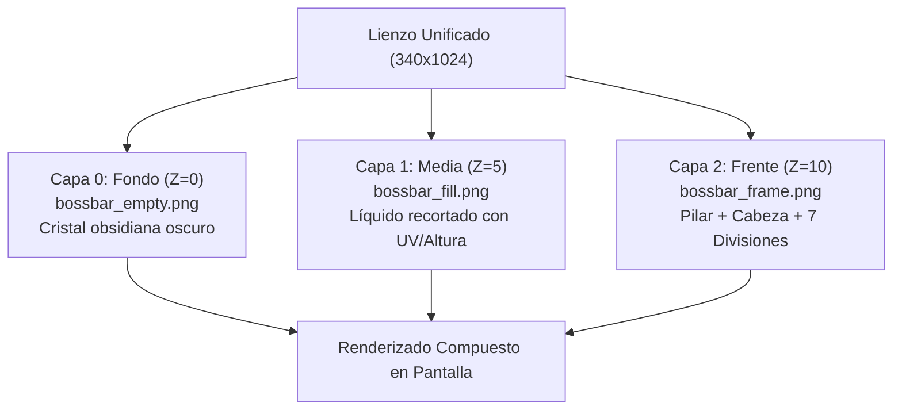
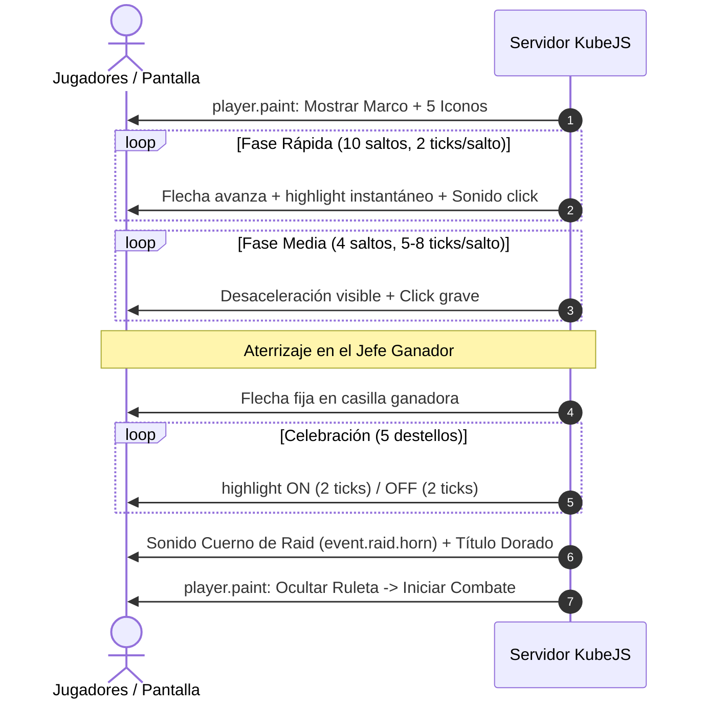

# Documentación Técnica: Boss Bars Verticales, Ruleta de Selección y Timer de La Forja

> **Proyecto:** Forja Evento - Arena Gladiadores (Minecraft 1.20.1 Forge / KubeJS 6)  
> **Fecha:** Noviembre 2026  
> **Estado:** Texturas y scripts de KubeJS Painter (`05_forja_painter.js`, `10_forja_lobby.js`, `20_forja_pve_apuestas.js`, `30_forja_pvp.js`) implementados y verificados al 100%.

---

## 1. Resumen Ejecutivo y Estado Actual

Se ha completado la fase de diseño, procesamiento gráfico y separación por capas de los tres sistemas visuales de la interfaz (HUD) para la arena:

1. **Boss Bars Verticales de 7 Segmentos:** Sustitución completa del scoreboard vanilla (`vida_combate`) por pilares verticales personalizados con la escultura temática de cada uno de los 5 jefes de Cataclysm, tubo de cristal y columna de líquido reactiva al daño en tiempo real.
2. **Ruleta Horizontal de Sorteo de Jefes:** Animación previa al combate sobre un marco netherite con 5 casillas discretas, flecha indicadora deslizante (`▼`), parpadeo individual por casilla al transitar y celebración de 5 destellos luminosos sobre el jefe ganador pre-seleccionado.
3. **Timer Horizontal de La Forja (Reloj de Arena):** Medidor estético superior de netherite y oro con reloj de arena central de cristal místico y 6 cámaras de fuego/magma (3 a la izquierda y 3 a la derecha) para controlar todas las fases del evento (Apuestas 30s, Combate 180s, Intermisión 120s, PvP 300s).

### Estado de los Recursos Generados
Todas las texturas han sido procesadas mediante algoritmos de segmentación y verificación matemática (`Max diff = 0` en composición alfa), guardadas en:
- `minecraft/kubejs/assets/forja/textures/gui/`
- `servidor_local/kubejs/assets/forja/textures/gui/`

---

## 2. Catálogo de Jefes y Texturas

### 2.1 Los 5 Jefes de Cataclysm (500 HP c/u)

| Slot | Jefe | HP Máxima | Temática Visual | Color de Líquido |
| :---: | :--- | :---: | :--- | :--- |
| **1** | **Kobolediator** | 500 HP | Gladiador con cuernos, casco de combate y obsidiana | Ámbar / Lava fundida (`#D57F0E`) |
| **2** | **Ender Golem** | 500 HP | Titán del End, runas moradas y placa de piedra oscura | Púrpura del Vacío (`#C001FC`) |
| **3** | **Wadjet** | 500 HP | Deidad egipcia de las arenas, lanza y tocado dorado | Oro solar del desierto (`#F0BB13`) |
| **4** | **Aptrgangr** | 500 HP | Coloso nórdico, hacha helada y runas de escarcha | Cian escarcha espectral (`#2AC0DB`) |
| **5** | **Prowler and Watchers** | 500 HP *(300 + 2×100)* | Centinela mecánico con propulsores y ojos láser | Rojo láser de alerta (`#FD193A`) |

---

## 3. Arquitectura Gráfica de las Boss Bars

Cada barra de vida vertical se compone de una **arquitectura de 3 capas superpuestas (Sandwich KubeJS Painter)** sobre un lienzo estandarizado de **340 × 1024 píxeles**:

```
[CAPA 2: Frente (Z=10)]   bossbar_frame.png  -> Escultura de piedra + Divisiones + Ventana transparente
[CAPA 1: Media  (Z=5)]    bossbar_fill.png   -> Líquido luminiscente que baja según HP
[CAPA 0: Fondo  (Z=0)]    bossbar_empty.png  -> Cristal oscuro/vacío detrás del líquido
```



### 3.1 Archivos por Jefe (`textures/gui/bossbars/<id>/`)
* **`bossbar_frame.png` (340×1024):** Contiene la cabeza tallada del jefe en la parte superior, los bordes de piedra exteriores, las 7 divisiones horizontales de retención y la base. El espacio interior del líquido tiene **alfa = 0**, permitiendo ver el líquido que corre por detrás.
* **`bossbar_fill.png` (340×1024):** Columna de líquido puro brillante ($X \in [114, 225]$, $Y \in [304, 968]$). El exterior y las divisiones están vacíos.
* **`bossbar_empty.png` (340×1024):** Fondo de cristal oscuro con viñeta para simular profundidad cuando el líquido se drena.
* **`bossbar_full.png` (340×1024):** Textura de referencia completa y sellada.
* **`icon.png` (128×128):** Cabeza del jefe aislada y centrada con transparencia para la ruleta.

### 3.2 Matemáticas de Coordenadas y Drenaje
* **Inicio del Tubo de Líquido:** $Y_{top} = 304$ px ($V_0 = 304 / 1024 \approx 0.296875$)
* **Fin del Tubo de Líquido:** $Y_{bot} = 968$ px ($V_1 = 968 / 1024 \approx 0.9453125$)
* **Altura Total de Líquido:** $H_{tubo} = 664$ px ($\Delta V \approx 0.6484375$)
* **Segmentos:** 7 segmentos uniformes divididos a las alturas $Y \approx [304, 384, 484, 580, 676, 772, 868, 968]$.
* **Fórmula de Vaciado Dinámico:**
  $$\text{Ratio} = \frac{\text{HP Actual}}{\text{HP Máxima}}$$
  $$V_{corte} = V_{bot} - (V_{bot} - V_{top}) \times \text{Ratio}$$

---

## 4. Arquitectura Gráfica de la Ruleta de Selección

La ruleta opera como un widget GUI horizontal colocado al centro de la pantalla durante la fase de selección pre-combate.

```
[Flecha Indicadora]    ▼ (Deslizante X: 180 -> 347 -> 513 -> 680 -> 846)
[Marco Netherite]     [ 1: Kobolediator ][ 2: Ender Golem ][ 3: Wadjet ][ 4: Aptrgangr ][ 5: Prowler ]
[Highlight / Pulso]   Marco dorado resplandeciente en la casilla activa
```

### 4.1 Archivos de la Ruleta (`textures/gui/roulette/`)
* **`frame.png` (1024×434):** Marco de obsidiana y netherite con 5 casillas cuadradas centradas verticalmente en $Y = 225$. Fondo exterior transparente. Flecha original eliminada y borde superior restaurado.
* **`arrow.png` (105×82):** Puntero triangular `▼` con flamas de lava extraído como sprite independiente.
* **`highlight.png` (128×128):** Borde resplandeciente dorado/fuego (`#FFD700` a `#FF780A`) con pulso interior cálido translúcido.
* **`icons/<boss>.png` (128×128):** Icono nítido de la cabeza de cada jefe:
  - `kobolediator.png`
  - `ender_golem.png`
  - `wadjet.png`
  - `aptrgangr.png`
  - `prowler_and_watcher.png`

### 4.2 Centros de Casillas en el Marco (1024 px de ancho)
| Casilla | Jefe Asociado | Coordenada X Centro | Rango X Casilla |
| :---: | :--- | :---: | :---: |
| **0** | Kobolediator | **180** | 128 - 233 |
| **1** | Ender Golem | **347** | 294 - 400 |
| **2** | Wadjet | **513** | 461 - 566 |
| **3** | Aptrgangr | **680** | 627 - 733 |
| **4** | Prowler and Watchers | **846** | 793 - 899 |

*Distancia inter-casillas:* $\approx 166.5$ píxeles constantes.

---

## 5. Plan de Animación de la Ruleta (Lógica Servidor-Cliente)

### 5.1 Determinación Previa
El servidor ejecuta el sorteo interno **antes** de comenzar la animación:
```javascript
const JEFES = ['kobolediator', 'ender_golem', 'wadjet', 'aptrgangr', 'prowler_and_watcher'];
let indiceGanador = Math.floor(Math.random() * JEFES.length); // 0 a 4
```
La animación se planifica para recorrer un total de **vueltas completas + salto final**:
$$\text{Total Saltos} = (2 \times 5) + \text{indiceGanador} = 10 + \text{indiceGanador}$$

### 5.2 Curva de Desaceleración (Easing Timeline)



1. **Fase Rápida (Giros veloces):** 2 ticks por casilla (~100 ms). Sonido `block.note_block.hat` (pitch alto 1.8).
2. **Fase Media (Desaceleración):** Saltos de 4 ticks, 6 ticks, 9 ticks, 14 ticks. El público percibe la tensión del frenado.
3. **Fase Final (Llegada al ganador):** Salto al slot final con retardo de 20 ticks.
4. **Celebración de Victoria (5 Parpadeos):**
   - 5 pulsos rápidos de `highlight.png` (2 ticks encendido, 2 ticks apagado).
   - Reproducción del cuerno de asalto: `playsound minecraft:event.raid.horn master @a ~ ~ ~ 1 1`.
   - Mensaje en pantalla con título grande del jefe sorteado.
   - Duración total de la ruleta: $\approx 5.5$ segundos.

---

## 6. Arquitectura Gráfica del Timer de La Forja (Reloj de Arena)

El timer opera como un widget GUI superior central (`alignX: 'center'`, `alignY: 'top'`, `y: 10`) con una resolución nativa de **1024 × 128 píxeles** (potencia de 2 optimizada para OpenGL).

```
[Extremo Izq]  [ Cám 1 ][ Cám 2 ][ Cám 3 ]  [ RELOJ DE ARENA ]  [ Cám 4 ][ Cám 5 ][ Cám 6 ]  [Extremo Der]
                   ( 3 cámaras izq )             ( Centro )            ( 3 cámaras der )
```

### 6.1 Separación por Capas del Timer (`textures/gui/timer/`)
* **`timer_frame.png` (1024×128):** Marco de netherite oscuro con ribetes de oro, remates de alas en los extremos, 4 divisiones metálicas tubulares y la estructura del reloj de arena central. Las 6 cámaras de fuego y el cristal del bulbo tienen **alfa = 0**.
* **`timer_fill.png` (1024×128):** Fuego ardiente y ascuas doradas en las 6 cámaras ($Y \in [42, 67]$), más la arena mística resplandeciente del reloj.
* **`timer_empty.png` (1024×128):** Fondo de cristal oscuro de obsidiana con viñeta suave (`[18, 16, 22, 230]`) que se revela conforme el tiempo se agota.
* **`timer_full.png` (1024×128):** Textura sellada de referencia.
* **Verificación de capas:** $\text{Max diff} = 0$ entre la composición multicapa y el original completo.

### 6.2 Coordenadas Horizontales de las Cámaras (Lienzo 1024 px)
* **Extremo Izquierdo (Ala/Gema):** $X \in [0, 37]$
* **Cámara 1:** $X \in [38, 164]$ (Ancho: 127 px)
* **Divisor 1:** $X \in [165, 176]$ (Ancho: 12 px)
* **Cámara 2:** $X \in [177, 303]$ (Ancho: 127 px)
* **Divisor 2:** $X \in [304, 316]$ (Ancho: 13 px)
* **Cámara 3:** $X \in [317, 446]$ (Ancho: 130 px)
* **Reloj de Arena Central:** $X \in [450, 574]$ (Centro: $X = 512$, Alto: $Y \in [9, 107]$)
* **Cámara 4:** $X \in [578, 705]$ (Ancho: 128 px)
* **Divisor 3:** $X \in [706, 717]$ (Ancho: 12 px)
* **Cámara 5:** $X \in [718, 844]$ (Ancho: 127 px)
* **Divisor 4:** $X \in [845, 857]$ (Ancho: 13 px)
* **Cámara 6:** $X \in [858, 986]$ (Ancho: 129 px)
* **Extremo Derecho (Ala/Gema):** $X \in [987, 1023]$

### 6.3 Lógica Dinámica de Vaciado en KubeJS
El medidor se adapta a cualquier fase del evento calculando la proporción de tiempo:
$$\text{Ratio} = \frac{\text{Segundos Restantes}}{\text{Segundos Totales de la Fase}}$$

1. **Modo de Vaciado Simétrico (De afuera hacia adentro):**  
   Conforme avanza el tiempo, las cámaras se van apagando en parejas simétricas:
   * $100\% \to 66\%$: Se drenan las cámaras exteriores (1 y 6).
   * $66\% \to 33\%$: Se drenan las cámaras intermedias (2 y 5).
   * $33\% \to 0\%$: Se drenan las cámaras centrales (3 y 4) junto al reloj de arena.
2. **Minutero Digital Inferior:**  
   Justo debajo del reloj de arena central ($X = 512$, $Y = 28$ relativo a la GUI), un elemento de texto KubeJS Painter muestra el minutero en tiempo real: `03:00`, `02:15`, `00:30`, cambiando a rojo parpadeante en los últimos 10 segundos.

---

## 7. Arquitectura Gráfica de la Player Bar (Barra de Vida de Gladiador)

La barra de vida del jugador utiliza el mismo lienzo unificado vertical de **340 × 1024 píxeles** que las Boss Bars, garantizando una simetría 1:1 en pantalla (`alignX: 'left'`, `x: 30`, `y: 40`, `w: 24`, `h: 72`).

```
[ CAPITEL / PLATAFORMA ]  -> Y=[185, 230] (Soporta avatar/cabeza del jugador)
[ 7 CILINDROS DE VIDA ]   -> Y=[235, 895], X=[120, 218] (Líquido rojo de salud)
[ PEDESTAL CON RUNAS ]    -> Y=[909, 1023] (Base de piedra con inscripciones)
```

### 7.1 Archivos de la Player Bar (`textures/gui/playerbar/`)
* **`playerbar_frame.png` (340×1024):** Columna de piedra clásica con capitel superior plano, soportes y 7 anillos de metal remachados, pedestal rúnico inferior. Las 7 cámaras de líquido tienen **alfa = 0**.
* **`playerbar_fill.png` (340×1024):** Los 7 cilindros de líquido rojo de salud resplandeciente ($X \in [120, 218]$, $Y \in [235, 895]$).
* **`playerbar_empty.png` (340×1024):** Tubo de cristal oscuro con viñeta (`[16, 14, 20, 230]`) que se muestra al perder corazones.
* **`playerbar_full.png` (340×1024):** Textura sellada completa de referencia.
* **Verificación de capas:** $\text{Max diff} = 0$ en composición alfa.

### 7.2 Lógica de Pantalla y Texto en PvE y PvP

#### A. En PvE (Gladiador vs Jefe):
* **Lado Izquierdo:** `playerbar` del jugador combatiente.
  - Arriba: Cabeza del skin del jugador (`forja_pve_avatar`).
  - Debajo del pilar: Texto en verde esmeralda `[ JuanRM7  ❤ 20/20 ]`.
* **Centro Superior:** `timer` de La Forja con minutero digital `[ 02:45 ]`.
* **Lado Derecho:** `bossbar` del jefe activo con texto en rojo oscuro `[ Kobolediator  ❤ 500/500 ]`.

#### B. En PvP (Gladiador 1 vs Gladiador 2):
* **Lado Izquierdo:** `playerbar` con texto azul/verde `[ kaki1242  ❤ 18/20 ]`.
* **Centro Superior:** `timer` con cuenta regresiva de 5 minutos `[ 04:30 ]`.
* **Lado Derecho:** `playerbar` con texto rojo/naranja `[ JuanRM7  ❤ 14/20 ]`.

---

## 8. Monitoreo de Vida del Combate (`20_forja_pve_apuestas.js` y `30_forja_pvp.js`)

### 8.1 Cálculo Especial para Prowler and Watchers
En Cataclysm, el encuentro de Prowler invoca dos Watchers auxiliares:
- `cataclysm:the_prowler`: 300 HP base.
- `cataclysm:the_watcher` (x2): 100 HP base cada uno.
- **HP Total Combinada:** $300 + 100 + 100 = 500$ HP.

El script de monitoreo sumará en cada tick la vida de los 3 mobs vivos:
```javascript
function calcularHpProwler(level, arena) {
    let prowler = buscarEntidad(level, 'cataclysm:the_prowler', arena);
    let watchers = buscarEntidades(level, 'cataclysm:the_watcher', arena);
    
    let hpActual = 0;
    if (prowler && prowler.isAlive()) hpActual += prowler.getHealth();
    watchers.forEach(w => {
        if (w.isAlive()) hpActual += w.getHealth();
    });
    return Math.min(500, Math.max(0, hpActual));
}
```

### 8.2 Bucle de Actualización Painter
Durante el combate activo, un temporizador cada 4 ticks (0.2 s) evalúa la salud de las entidades y actualiza los elementos Painter:
- `forja_bossbar_fill` y `forja_playerbar_fill`: Ajusta la altura `h`, posición `y` y coordenada de textura `v0` para simular el descenso del líquido en tiempo real.
- Textos dinámicos en pantalla con HP exacto y colores de bando.

---

## 9. Plan de Implementación por Fases

| Hito | Descripción | Estado |
| :---: | :--- | :---: |
| **Hito 1** | Extracción, recorte y generación de texturas transparentes (Bosses, Ruleta, Timer y Player Bar) | **COMPLETADO** |
| **Hito 2** | Creación del módulo Painter (`05_forja_painter.js`) con comando de prueba `/forjahud` | **COMPLETADO** |
| **Hito 3** | Reemplazo del scoreboard `vida_combate` por la Boss Bar y Player Bar Painter (`20_forja_pve_apuestas.js`, `30_forja_pvp.js`) | **COMPLETADO** |
| **Hito 4** | Integración de la fase de Ruleta interactiva (`PVE_RULETA`) previa al combate PvE | **COMPLETADO** |
| **Hito 5** | Integración del Timer universal con minutero digital en todas las fases (`10_forja_lobby.js`, PvE, PvP) | **COMPLETADO** |
| **Hito 6** | Verificación sintáctica, pruebas unitarias de payloads Painter y sincronización con `servidor_local` | **COMPLETADO** |
| **Hito 7** | Despliegue a repositorio GitHub (`origin/main`) | **COMPLETADO** |

---
*Fin del documento técnico.*
